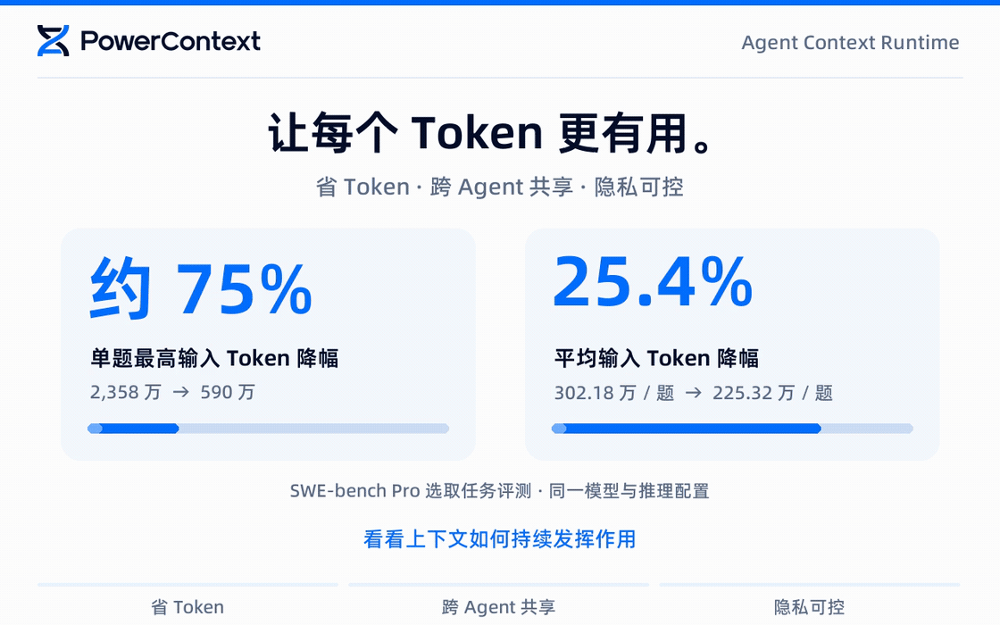

# PowerContext

**Agent Context Runtime · 降低长任务 Token 开销**

| 单题最高输入量下降 | 平均输入 Token 减少 |
| :---: | :---: |
| **约 75%** | **25.4%** |



<sub>能力示意；评测数字来自所选 SWE-bench Pro 任务。</sub>

## 省 Token：少重复读取，少重复输入

按需读取当前任务需要的背景、记忆和经验，减少重复输入。

复用已准备的记忆上下文，减少重复检索与组装；在内部记忆与经验请求中共享相同内容，减少重复传递。

[按需召回](https://github.com/oceanbase/powercontext/blob/20f64d72b13594ad834fcd342f5927d0d0102abb/docs/zh/docs/workflows/prepare-context-text.md) · [上下文复用](https://github.com/oceanbase/powercontext/blob/20f64d72b13594ad834fcd342f5927d0d0102abb/docs/zh/docs/operate/context-protection.md) · [输入共享](https://github.com/oceanbase/powercontext/blob/20f64d72b13594ad834fcd342f5927d0d0102abb/docs/zh/docs/operate/input-encoding.md)

## 跨 Agent 共享：上下文随任务延续

Codex 已经分析的问题、选定的方案、尚未完成的步骤，保存到 PowerContext 后，Claude Code 可以接着使用。

共享任务记忆，交接当前状态与下一步。换会话、换 Agent 或交给同事时，已经确认的决策和进展都能继续使用。

[记忆与任务交接](https://github.com/oceanbase/powercontext/blob/20f64d72b13594ad834fcd342f5927d0d0102abb/docs/zh/docs/workflows/memory-and-handoff.md) · [Codex 接入](https://github.com/oceanbase/powercontext/blob/20f64d72b13594ad834fcd342f5927d0d0102abb/docs/zh/docs/integrations/codex.md) · [Claude Code 接入](https://github.com/oceanbase/powercontext/blob/20f64d72b13594ad834fcd342f5927d0d0102abb/docs/zh/docs/integrations/claude-code.md)

## 隐私可控：自己决定上下文如何使用

上下文可以存储在本地，通过访问权限管理共享范围，查看内容的来源与修订记录。

PowerContext 对自身模型请求与响应按策略执行隐私检查，命中禁止规则时阻断。

[存储与部署](https://github.com/oceanbase/powercontext/blob/20f64d72b13594ad834fcd342f5927d0d0102abb/docs/zh/docs/get-started/install-and-run.md) · [访问控制](https://github.com/oceanbase/powercontext/blob/20f64d72b13594ad834fcd342f5927d0d0102abb/docs/zh/docs/workflows/scopes-and-access.md) · [推理隐私保护](https://github.com/oceanbase/powercontext/blob/20f64d72b13594ad834fcd342f5927d0d0102abb/docs/zh/docs/operate/inference-protection.md)

## 快速开始

使用 [uv](https://docs.astral.sh/uv/getting-started/installation/) 安装 CLI 与 Server：

```bash
uv tool install --force "powercontext[cli,server]==1.5.0"
```

按[快速开始](https://github.com/oceanbase/powercontext/blob/20f64d72b13594ad834fcd342f5927d0d0102abb/docs/zh/docs/get-started/quickstart.md)接入 Agent，体验“保存上下文 → 新会话召回”。也可参考[手动启动](https://github.com/oceanbase/powercontext/blob/20f64d72b13594ad834fcd342f5927d0d0102abb/docs/zh/docs/get-started/manual-start.md)。

## 接入你的 Agent

优先从 [Codex](https://github.com/oceanbase/powercontext/blob/20f64d72b13594ad834fcd342f5927d0d0102abb/docs/zh/docs/integrations/codex.md) 或 [Claude Code](https://github.com/oceanbase/powercontext/blob/20f64d72b13594ad834fcd342f5927d0d0102abb/docs/zh/docs/integrations/claude-code.md) 开始。也可接入 [OpenCode](https://github.com/oceanbase/powercontext/blob/20f64d72b13594ad834fcd342f5927d0d0102abb/docs/zh/docs/integrations/opencode.md)、[OpenClaw](https://github.com/oceanbase/powercontext/blob/20f64d72b13594ad834fcd342f5927d0d0102abb/docs/zh/docs/integrations/openclaw.md)、[Pi](https://github.com/oceanbase/powercontext/blob/20f64d72b13594ad834fcd342f5927d0d0102abb/docs/zh/docs/integrations/pi.md) 等宿主；各集成支持的能力见[能力矩阵](https://github.com/oceanbase/powercontext/blob/20f64d72b13594ad834fcd342f5927d0d0102abb/docs/zh/docs/integrations/capabilities.md)。

应用可以通过 Python Client、HTTP API、MCP 或进程内 Core SDK 使用 PowerContext，详见[接口说明](https://powercontext.oceanbase.io/zh/docs/develop/interfaces/)。

## 评测口径

<details>
<summary>SWE-bench Pro 输入 Token 对照</summary>

在所选 SWE-bench Pro 任务上，使用相同模型、任务与推理配置，对比启用和未启用 PowerContext：

| 指标 | 未启用 | 启用 | 输入 Token 减少 |
| --- | ---: | ---: | ---: |
| 单题最高输入量 | 2,358 万 | 590 万 | 约 75% |
| 平均用量，折算每 100 题 | 3.0218 亿 | 2.2532 亿 | 25.4% |

“单题最高输入量”分别取两组任务输入量的最大值，不表示某一道题的最大降幅。以上仅统计输入 Token；动图为能力示意。

其他评测：[评测目录](https://github.com/oceanbase/powercontext/blob/20f64d72b13594ad834fcd342f5927d0d0102abb/evaluation/README.md) · [官网评测页](https://powercontext.oceanbase.io/zh/benchmarks/)。

</details>

## 文档与贡献

[](https://pypi.org/project/powercontext/)
[](LICENSE)
[](https://discord.com/invite/74cF8vbNEs)
[](https://deepwiki.com/oceanbase/powercontext)

*[English](https://github.com/oceanbase/powercontext/blob/20f64d72b13594ad834fcd342f5927d0d0102abb/README.md) · [中文](README_CN.md) · [日本語](https://github.com/oceanbase/powercontext/blob/20f64d72b13594ad834fcd342f5927d0d0102abb/README_JP.md)*

[网站](https://powercontext.oceanbase.io/zh/) · [快速开始](https://github.com/oceanbase/powercontext/blob/20f64d72b13594ad834fcd342f5927d0d0102abb/docs/zh/docs/get-started/quickstart.md) · [接入 Agent](https://powercontext.oceanbase.io/zh/docs/integrations/) · [评测](#评测口径) · [文档](https://powercontext.oceanbase.io/zh/docs/)

- [使用指南](https://powercontext.oceanbase.io/zh/docs/) · [部署与运维](https://powercontext.oceanbase.io/zh/docs/operate/) · [开发与 API](https://powercontext.oceanbase.io/zh/docs/develop/)
- [桌面预览](https://github.com/oceanbase/powercontext/blob/20f64d72b13594ad834fcd342f5927d0d0102abb/desktop/README.zh.md) · [评测工具](https://github.com/oceanbase/powercontext/blob/20f64d72b13594ad834fcd342f5927d0d0102abb/evaluation/README.md)
- [贡献指南](https://github.com/oceanbase/powercontext/blob/20f64d72b13594ad834fcd342f5927d0d0102abb/CONTRIBUTING.md) · [报告问题](https://github.com/oceanbase/powercontext/issues) · [加入 Discord](https://discord.com/invite/74cF8vbNEs)

PowerContext 是 [PowerMem](https://www.powermem.ai/) 的后续项目。

### 贡献者

感谢每一位为 PowerContext 作出贡献的伙伴。

<a href="https://github.com/oceanbase/powercontext/graphs/contributors">
  
</a>

[查看全部贡献者](https://github.com/oceanbase/powercontext/graphs/contributors) · [参与贡献](https://github.com/oceanbase/powercontext/blob/20f64d72b13594ad834fcd342f5927d0d0102abb/CONTRIBUTING.md)

### 许可证

PowerContext 基于 [Apache License 2.0](LICENSE) 发布。
