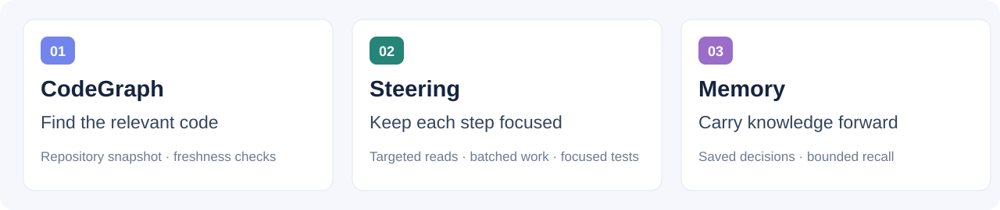

<p align="center">
  <picture>
    <source media="(prefers-color-scheme: dark)" srcset="docs/assets/readme-hero-en-dark.gif" />
    
  </picture>
</p>

<p align="center">
  <a href="#quick-start"><b>Get started</b></a> &nbsp; · &nbsp;
  <a href="#proof-it-works">See the proof</a> &nbsp; · &nbsp;
  <a href="#put-context-to-work">Use cases</a> &nbsp; · &nbsp;
  <a href="https://powercontext.oceanbase.io/en/docs/">Documentation</a> &nbsp; · &nbsp;
  <a href="https://discord.com/invite/74cF8vbNEs">Discord</a>
</p>
<p align="center">
  <a href="README.md">English</a> · <a href="README_CN.md">中文</a> · <a href="README_JP.md">日本語</a> &nbsp; / &nbsp;
  <a href="https://pypi.org/project/powercontext/">Python package</a> · <a href="LICENSE">Apache 2.0</a>
</p>

## Why PowerContext?

**The right context. Faster progress. Fewer tokens.** PowerContext brings relevant knowledge, user preferences, task progress, and past experience into the current task, helping agents spend less time searching again, asking the same questions, and repeating unsuccessful attempts.

- **Relevant context, with evidence.** Find knowledge and code for the task, preserve sources, and check code freshness before use.
- **Faster progress, fewer round trips.** Pick up from existing progress, using confirmed approaches and constraints to reduce repeated discovery and trial and error.
- **Less total effort and token use.** Make each model call more useful, reduce unnecessary reasoning and tool round trips, and spend less time waiting or explaining the background again.

## What is PowerContext?

**PowerContext is an open-source context service for AI agents.** It turns conversations, documents, and work records into knowledge that can be searched, updated, and traced to its sources, helping agents understand the person, know the project, and continue from where work left off.

Each person can customize memory-processing prompts in their own Scope: what to remember, how to organize information, and how to build profiles and capture experience. Alongside personal profiles, project knowledge, and task handoffs, these prompts help accumulated context fit different people and ways of working.

Run it as a service through HTTP, MCP, Python, or Agent integrations, or embed Core in your own application. [Explore the product and workflows →](https://powercontext.oceanbase.io/en/docs/workflows/memory-and-handoff/)

## Proof it works

**Spend fewer tokens. Lower model costs.** On the same 24 SWE-bench Pro tasks, PowerContext used **32.57% fewer tokens** and delivered **15.42% lower estimated model cost**, including memory generation. Both groups solved the **same 16 tasks**.

**Solving alone uses 40.30% fewer tokens; including memory generation overhead, the reduction is 32.57%.** Saved memories can be reused in later sessions, extending the value of accumulated knowledge. This benchmark measures the current run; future reuse benefits have not been measured here.

**Best task: 63.49% fewer tokens and 51.98% lower estimated model cost.** Both runs passed case 456, with tokens falling from 2.30 million to 0.84 million, including memory generation.

[Explore the 24-task benchmark: results, methodology, and setup →](docs/benchmarks/token-savings/README.md)

### Coding: fewer detours, less wasted work

**Make each reasoning step more useful, with fewer round trips to finish the task.** Relevant code, clear working requirements, and past experience help agents find the next useful step. Our focus is the time and tokens needed for the whole task, reducing repeated exploration, rereading, and unproductive attempts.

This benchmark runs in **gateway mode**, with code retrieval, working guidance, and project memory enabled together:



**Extract memory. Reuse the cache.** The 32.57% reduction above includes memory-generation tokens. In gateway mode, you can enable prefix-cached memory extraction to reuse context prefixes from solving requests when eligible, lowering input costs on cache hits. In this benchmark, 97% of input to memory-generation calls with recorded cache fields hit the cache.

### Fewer model round trips

**In a separate test on the same 24 tasks, primary-model requests fell by 23.87%.** With memory and working guidance enabled, total requests fell from **708 to 539**, averaging **29.50 to 22.46 requests per task**. Both groups solved the **same 15 tasks**. These results are reported separately from the code retrieval, working guidance, and memory comparison at the top of this page. [See request counts and per-task records →](docs/benchmarks/token-savings/request-counts.md)

## Put context to work

### Your memory, your rules

**Everyone can define what is worth remembering.** Engineers may focus on technical decisions and incident causes; product managers on requirements and tradeoffs; creators on style preferences and story details. Customize prompts in your personal Scope to guide memory extraction, information organization, and profile generation. Each Scope keeps its own configuration and version history.

Profiles help agents understand you. Personal prompts let you shape how the system builds memories that are useful to you, so what you retain from each session better fits your work and habits.

[Prompt: customize memory rules →](https://powercontext.oceanbase.io/en/docs/workflows/manage-prompts/) · [Profile: understand each user →](https://powercontext.oceanbase.io/en/docs/workflows/use-profiles/)

### A new session, the same progress

**A pause in work does not have to mean starting over.** Keep track of what you investigated, what you verified, what is still blocked, and what comes next. In a new session or with another agent, check the current state and continue from the handoff.

Memory retains decisions and constraints; Handoff organizes goals, progress, and next steps. Use them for work that spans days, team collaboration, and handoffs between agents.

[Memory and Handoff: save progress and continue the task →](https://powercontext.oceanbase.io/en/docs/workflows/memory-and-handoff/)

### Keep the project history close

**Projects have a history. Your agent should know it.** Why was an approach chosen? What did the customer ask for? What has the research established? Turn information scattered across documents and discussions into topic knowledge that stays up to date, with background and evidence available when needed.

Topic Memory brings together progress on a subject, Memory retains specific facts, and Source preserves the original evidence. Use them for product development, customer projects, and long-running research.

[Topic Memory: build ongoing project knowledge →](https://powercontext.oceanbase.io/en/docs/workflows/topic-memory/) · [Source: return to the original evidence →](https://powercontext.oceanbase.io/en/docs/workflows/sources/)

### Solve it once, learn for next time

**Make one task's lessons the starting point for the next.** Retain effective methods, the conditions where they apply, failed approaches, and verification steps. When a similar task comes up, agents can look up past experience before deciding how to act.

Experience captures the situation, approach, and outcome. Repeatable procedures can become Skills, reviewed and exported for agents to use, so completed work continues to pay off.

[Experience: retain reusable lessons →](https://powercontext.oceanbase.io/en/docs/workflows/experience-and-skill-lifecycle/) · [Skill: export reviewed procedures →](https://powercontext.oceanbase.io/en/docs/workflows/create-and-export-skill/)

People, projects, and teams can manage context in their own Scopes, with access controls governing who can read and edit it. Version history and source references support verification, revision, and handoffs. [Explore Scopes and access control →](https://powercontext.oceanbase.io/en/docs/workflows/scopes-and-access/)

## Quick start

You need Python 3.11+, Git, and [uv](https://docs.astral.sh/uv/getting-started/installation/), plus the CLI of any Agent you want to connect. This setup pins version **1.5.2** for macOS and Linux; Windows support is experimental. The [installation script](https://powercontext.oceanbase.io/en/docs/get-started/install-and-run/#install-with-the-recommended-script) can also provision Python and uv.

Choose **Basic memory** in the wizard to try explicit saves and recall without a separate Server model API. Automatic extraction requires **Full memory** with Generation and Embedding credentials. SQLite is a simple first storage choice.

```bash
uv tool install --force "powercontext[cli,server]==1.5.2"
mkdir -p powercontext-config && cd powercontext-config
powercontext config init --language en --output .env
powercontext config validate --env-file .env
powercontext service install --env-file .env
powercontext service status
```

The service keeps running after you close the terminal. Linux requires an available `systemd --user` manager. The generated `.env` and `.env.next-steps.md` may contain credentials; keep them out of Git.

Load the generated configuration and check the service:

```bash
set -a
. ./.env
set +a
powercontext ready
powercontext capabilities
```

Follow **`.env.next-steps.md`** to create and bind your Scope, using the real `scope_id` returned by the creation request. Use the same Server and Scope in your Agent and Dashboard; changing directories does not create project isolation. After editing `.env`, reload it and rerun `powercontext service install --env-file .env` to apply the changes.

For Codex, install the matching integration:

```bash
powercontext setup codex --env-file .env --ref powercontext-v1.5.2
powercontext doctor codex
```

Before sending the first message in a new Codex session, open **`/hooks`** and trust the PowerContext hooks when prompted. The `UserPromptSubmit` hook must be enabled for automatic prompt capture and recall, even when MCP connects. [First-session checks and recovery →](https://powercontext.oceanbase.io/en/docs/integrations/codex/#first-session-hook-trust)

Verify the workflow you enabled:

- **Basic memory:** explicitly ask the Agent to save a project decision, then start a new session in the same Scope and recall it with a source reference.
- **Full memory:** confirm that an input appears as a Source, wait for configured processing to produce Topic Memory, then check that a related update is reflected and can be recalled in a new session.

`doctor codex` checks installation and connectivity only. Source capture alone does not create memory; automatic processing also depends on configured schedules and model work. The Agent still uses its own model in Basic memory mode. [Full setup guide →](https://powercontext.oceanbase.io/en/docs/get-started/quickstart/)

<sub>This starts the context service. It does not automatically reproduce the benchmark's Gateway, CodeGraph, or Steering configuration; see the evidence report.</sub>

## Fits your workflow

<!-- Add integrations using an original logo asset, a product name, and a documentation link. -->
<table width="100%">
  <tr>
    <td align="center" width="20%"><a href="https://powercontext.oceanbase.io/en/docs/integrations/codex/"><br />Codex</a></td>
    <td align="center" width="20%"><a href="https://powercontext.oceanbase.io/en/docs/integrations/claude-code/"><br />Claude Code</a></td>
    <td align="center" width="20%"><a href="https://github.com/oceanbase/powercontext/tree/master/integrations/minimax#readme"><br />MiniMax Code</a></td>
    <td align="center" width="20%"><a href="https://powercontext.oceanbase.io/en/docs/integrations/dsh/"><br />DeepSeek Harness</a></td>
    <td align="center" width="20%"><a href="https://powercontext.oceanbase.io/en/docs/integrations/zcode/"><br />ZCode</a></td>
  </tr>
  <tr>
    <td align="center" width="20%"><a href="https://powercontext.oceanbase.io/en/docs/integrations/kimi-code/"><br />Kimi Code</a></td>
    <td align="center" width="20%"><a href="https://github.com/oceanbase/powercontext/tree/master/integrations/hermes#readme"><br />Hermes Agent</a></td>
    <td align="center" width="20%"><a href="https://powercontext.oceanbase.io/en/docs/integrations/pi/"><br />Pi Coding Agent</a></td>
    <td align="center" width="20%"><a href="https://powercontext.oceanbase.io/en/docs/integrations/openclaw/"><br />OpenClaw</a></td>
    <td align="center" width="20%"><a href="https://powercontext.oceanbase.io/en/docs/integrations/opencode/"><br />OpenCode</a></td>
  </tr>
  <tr>
    <td align="center" width="20%"><a href="https://github.com/oceanbase/powercontext/tree/master/integrations/workbuddy#readme"><br />WorkBuddy</a></td>
    <td align="center" width="20%"><a href="https://github.com/oceanbase/powercontext/tree/master/integrations/bub#readme"><br />Bub</a></td>
    <td align="center" width="20%"><a href="https://powercontext.oceanbase.io/en/docs/integrations/pydantic-ai/"><br />Pydantic AI</a></td>
    <td align="center" width="20%"><a href="https://powercontext.oceanbase.io/en/docs/integrations/langchain/"><br />LangChain</a></td>
    <td align="center" width="20%"><a href="https://powercontext.oceanbase.io/en/docs/integrations/langgraph/"><br />LangGraph</a></td>
  </tr>
</table>

Codex is officially maintained; other Agent and Python framework integrations are community-maintained. Bub is for evaluation only. See the capability matrix for supported features.

[More integrations and capability comparison →](https://powercontext.oceanbase.io/en/docs/integrations/capabilities/)

**Apps & teams** — [Python / HTTP / MCP](https://powercontext.oceanbase.io/en/docs/develop/interfaces/) · [Memory & Handoff](https://powercontext.oceanbase.io/en/docs/workflows/memory-and-handoff/) · [Deployment & access](https://powercontext.oceanbase.io/en/docs/workflows/scopes-and-access/)

---

[Documentation](https://powercontext.oceanbase.io/en/docs/) · [Contribute](https://github.com/oceanbase/powercontext/blob/master/CONTRIBUTING.md) · [Issues](https://github.com/oceanbase/powercontext/issues) · [Discord](https://discord.com/invite/74cF8vbNEs)

PowerContext is the successor to [PowerMem](https://www.powermem.ai/). Released under [Apache 2.0](LICENSE).
