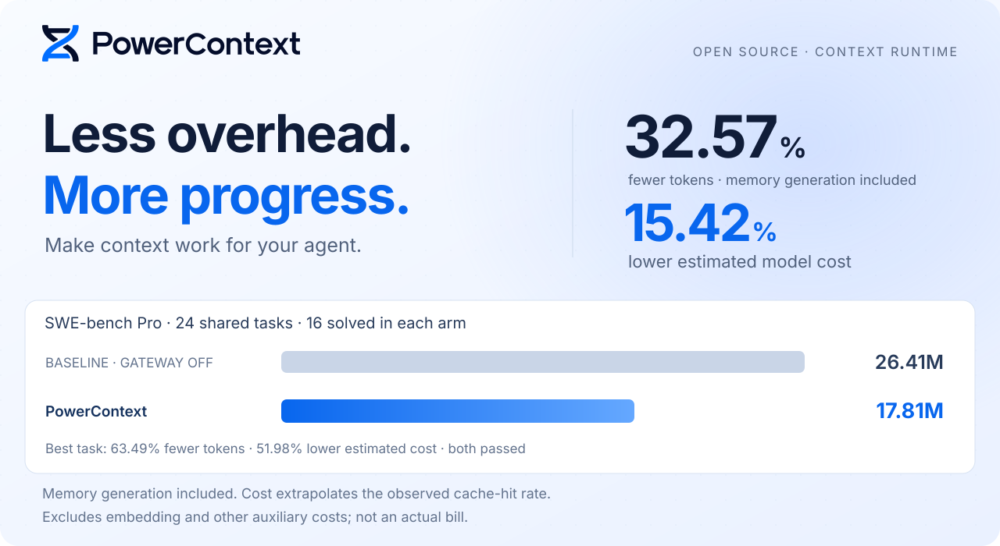
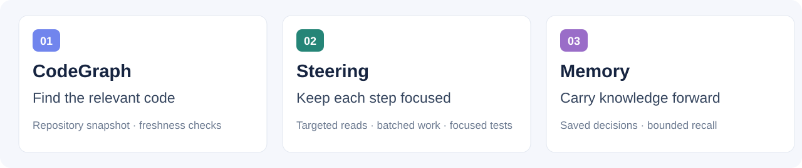

<p align="center">
  
</p>

<p align="center">
  <a href="#quick-start"><b>Get started</b></a> &nbsp; · &nbsp;
  <a href="#proof-it-works">See the proof</a> &nbsp; · &nbsp;
  <a href="https://powercontext.oceanbase.io/en/docs/">Documentation</a> &nbsp; · &nbsp;
  <a href="https://discord.com/invite/74cF8vbNEs">Discord</a>
</p>
<p align="center">
  <a href="README.md">English</a> · <a href="README_CN.md">中文</a> &nbsp; / &nbsp;
  <a href="https://pypi.org/project/powercontext/">Python package</a> · <a href="LICENSE">Apache 2.0</a>
</p>

## Why PowerContext?

**Your agent's tokens should move the task forward.** Less repeated searching, fewer unproductive round trips, and project knowledge that is still useful when the next session starts.

- **Focus on the task.** Bring relevant code and clear working guidance into the agent's path to a fix.
- **Keep your agent.** Connect Codex, Claude Code, and other supported hosts, or integrate with your own application.
- **Keep what you learn.** Retain decisions, constraints, and handoffs across sessions, agents, and teammates.

## What is PowerContext?

**An open-source context runtime for AI agents.** It manages code context, project memory, and task handoffs, bringing relevant context into the workflow when it is needed.



Configure the capabilities you need. Context is organized into **Scopes**, accessible through HTTP, MCP, Python, and agent integrations. [How it fits together →](https://powercontext.oceanbase.io/en/docs/workflows/memory-and-handoff/)

## Proof it works

<table>
<tr>
<td width="33%" align="center"><h3>40.30% ↓</h3><b>Total tokens · 24 tasks</b><br/>CodeGraph + Steering + Memory<br/><sub>16/24 solved in each arm</sub></td>
<td width="33%" align="center"><h3>36.18% ↓</h3><b>Total tokens · 121 tasks</b><br/>CodeGraph + Steering<br/><sub>82/121 vs. 83/121 solved</sub></td>
<td width="33%" align="center"><h3>85.71% ↓</h3><b>Best paired task</b><br/>CodeGraph + Steering · case 302<br/><sub>Both passed; not an average</sub></td>
</tr>
</table>

**One concrete task:** case 302 went from **1,240,658 → 177,343 tokens**, with both runs passing the official task grader.

Figures count primary-model input + output, including cache, using original/frozen selections. **Not billing reductions.** Post-task memory generation is additional. These figures come from Codex turn usage, not all gateway requests. [Task-level evidence and full comparisons →](docs/benchmarks/token-savings/README.md)

<details>
<summary>Test scope, auxiliary costs, and retries</summary>

In the detailed results, **C = CodeGraph, S = Steering, M = Memory**. Combined letters mean those features are enabled together. **Gateway OFF** is the control with all three disabled.

- On the same 24 tasks: S saves 27.12% (15/24 solved), CS 33.06% (15/24), MCS 40.30% (16/24); Gateway OFF solves 16/24. This is a completed-task intersection, not a random sample.
- MCS adds 2,041,992 post-task memory-generation tokens. Including them gives a 32.57% reduction, before other auxiliary work. No nonempty Memory injection was observed during solving; the savings do not establish cross-task memory benefits.
- Across 121 tasks, CodeGraph alone uses 10.53% more tokens. CS solves one fewer task than OFF. Implementation and validation routes vary; these runs do not guarantee savings on every task or equal quality.
- Conditional retry selections, all-attempt costs, cached and uncached tokens are separate in the evidence report. They are not mixed into the headline. MCS did not finish all 121 tasks.
- Tested with Codex CLI 0.162.1, GPT-5.6 Sol medium, a frozen development build and fresh databases per attempt. S is explicit guidance, not an installation default. OFF is an earlier frozen batch.

[Methodology](docs/benchmarks/token-savings/README.md) · [Data](docs/benchmarks/token-savings/results.json) · [Offline verifier](docs/benchmarks/token-savings/verify.py)

</details>

## Quick start

You need Python 3.11+, Git, and [uv](https://docs.astral.sh/uv/getting-started/installation/). This setup pins version 1.5.0 for macOS and Linux.

```bash
uv tool install --force "powercontext[cli,server]==1.5.0"
mkdir -p powercontext-config && cd powercontext-config
powercontext config init --language en --output .env
powercontext config validate --env-file .env
powercontext server run --env-file .env
```

Keep the service running. Follow **`.env.next-steps.md`** to create and bind your Scope. Start with Basic memory; automatic extraction requires Generation and Embedding credentials.

For Codex, install the matching integration in another terminal:

```bash
powercontext setup codex --ref powercontext-v1.5.0
powercontext doctor codex
```

Start a new session and trust the hooks when prompted. Save a project decision, then recall it in a later session. [Full setup guide →](https://powercontext.oceanbase.io/en/docs/get-started/quickstart/)

<sub>This starts the context service. It does not automatically reproduce the benchmark's Gateway, CodeGraph, or Steering configuration; see the evidence report.</sub>

## Fits your workflow

**Agents** — [Codex](https://powercontext.oceanbase.io/en/docs/integrations/codex/) · [Claude Code](https://powercontext.oceanbase.io/en/docs/integrations/claude-code/) · [OpenCode, OpenClaw, Pi and capability matrix](https://powercontext.oceanbase.io/en/docs/integrations/capabilities/)

**Apps & teams** — [Python / HTTP / MCP](https://powercontext.oceanbase.io/en/docs/develop/interfaces/) · [Memory & Handoff](https://powercontext.oceanbase.io/en/docs/workflows/memory-and-handoff/) · [Deployment & access](https://powercontext.oceanbase.io/en/docs/workflows/scopes-and-access/)

---

[Documentation](https://powercontext.oceanbase.io/en/docs/) · [Contribute](https://github.com/oceanbase/powercontext/blob/main/CONTRIBUTING.md) · [Issues](https://github.com/oceanbase/powercontext/issues) · [Discord](https://discord.com/invite/74cF8vbNEs)

PowerContext is the successor to [PowerMem](https://www.powermem.ai/). Released under [Apache 2.0](LICENSE).
