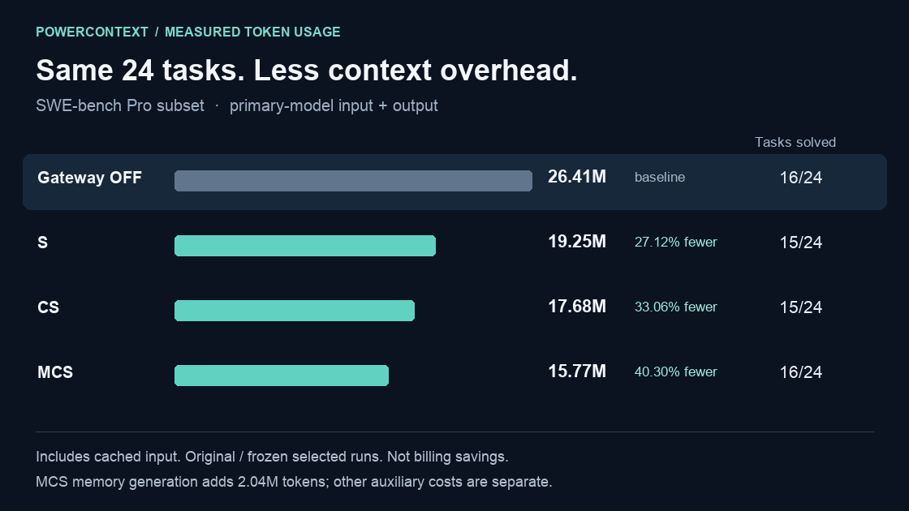

# PowerContext

**Spend fewer tokens getting the work done.**

An open-source context runtime for AI agents: bring relevant code and project knowledge into the task, guide focused work, and keep useful context for the next session.

[PyPI](https://pypi.org/project/powercontext/) · [Apache 2.0](LICENSE) · [Discord](https://discord.com/invite/74cF8vbNEs)

[English](README.md) · [中文](README_CN.md)

[Why PowerContext](#why-powercontext) · [What it is](#what-is-powercontext) · [Proof](#proof-it-works) · [Quick start](#quick-start) · [Docs](https://powercontext.oceanbase.io/en/docs/)

## Why PowerContext?

Long coding tasks spend tokens on more than the fix: searching the repository, reading files, carrying those results into later requests, and revisiting failed approaches. PowerContext gives you control over the context and guidance your agent receives.

**40.30% fewer primary-model tokens on 24 shared coding tasks**, with 16 tasks solved in both MCS and the control. Here is the full comparison, including the simpler configurations:

| Configuration | Total tokens | Reduction vs. OFF | Tasks solved |
| :--- | ---: | ---: | ---: |
| Gateway OFF — control | 26,410,221 | — | 16/24 |
| Steering (S) | 19,247,973 | **27.12%** | 15/24 |
| CodeGraph + Steering (CS) | 17,680,166 | **33.06%** | 15/24 |
| Memory + CodeGraph + Steering (MCS) | 15,766,986 | **40.30%** | 16/24 |

Same 24 tasks, same model configuration; original/frozen selections, including failed solutions. Token totals include cached input and output. They are **not billing reductions**. MCS also used 2,041,992 tokens for post-task memory generation; including that component makes its reduction **32.57%**, before other auxiliary work. [Accounting and task-level data →](docs/benchmarks/token-savings/README.md)



## What is PowerContext?

**PowerContext manages the context around your agent.** It provides a shared service for code context, project memory, and task handoffs, with HTTP, MCP, Python, and agent integrations. You keep your agent and model; configure which context capabilities to use.

| Capability | What it does | What it is meant to avoid |
| :--- | :--- | :--- |
| **CodeGraph** | Retrieves code evidence tied to a repository snapshot; freshness checks guard reuse. | Starting every search from the whole repository. |
| **Steering** | Adds explicit task guidance about targeted reads, batched work, and focused validation. | Unnecessary tool round trips and extended environment-repair detours. |
| **Memory** | Saves useful decisions and facts, then recalls relevant context within a budget. | Rediscovering project knowledge in later sessions. |

The benchmark's S configuration used an explicit [489-byte guidance text](docs/benchmarks/token-savings/steering.txt). It is an experimental setting, **not a claim that installing PowerContext automatically enables it**. CodeGraph and Memory need their own configuration; agent integrations expose different capabilities.

```text
Your task + project context
             ↓
 PowerContext selects context for the task
             ↓
 Your agent searches, edits and validates
             ↓
 Useful outcomes can become context for later sessions
```

Context belongs to a **Scope**, so a project can retain its decisions and handoffs across sessions and supported agents. Memory and Handoff also have value beyond token reduction: the next person can inspect the saved state and continue the work.

## Proof it works

### Does it hold beyond the 24-task subset?

The completed **121-task** comparison shows lower primary-model token totals with Steering enabled:

| Configuration | Total tokens | Reduction vs. Gateway OFF | Tasks solved |
| :--- | ---: | ---: | ---: |
| Gateway OFF | 141,869,214 | — | 83/121 |
| Steering (S) | 91,284,652 | **35.66%** | 81/121 |
| CodeGraph + Steering (CS) | 90,544,517 | **36.18%** | 82/121 |

These are the original settled results, not success-selected retries. CS solved one fewer task than OFF; this run does not establish equal quality. CodeGraph alone used **10.53% more** tokens than Gateway OFF, so adding a capability is not a guarantee of savings. [All five configurations and retry accounting →](docs/benchmarks/token-savings/README.md)

### Can I inspect a concrete task?

On **case 302, navidrome/navidrome**, both Gateway OFF and CS passed the official task grader:

| Gateway OFF | CodeGraph + Steering | Tokens saved |
| ---: | ---: | ---: |
| 1,240,658 | 177,343 | **85.71%** |

This is the largest paired CS reduction in the 121-task set, not its average. Model choices, implementation routes, and validation steps vary between runs; the observed reduction is not a causal attribution to retrieval alone.

### Can I check the numbers?

The [evidence package](docs/benchmarks/token-savings/README.md) includes task IDs, per-record usage, outcomes, source digests, original and retry-selected results, and an offline verifier:

```bash
python3 docs/benchmarks/token-savings/verify.py
```

It recomputes the published totals without running a model. Full raw trajectories are retained separately; the numeric export is sufficient to recompute these tables, not to independently reproduce the task grades.

**What this test says about Memory:** every attempt started with a new empty database. The 24 MCS records show no nonempty memory injection during solving; memory was generated afterward. These results measure a configuration's token usage, not a demonstrated benefit from cross-task memory reuse. The MCS experiment was not completed over all 121 tasks.

## Quick start

### 1. Start your context service

You need Python 3.11+, Git, and [uv](https://docs.astral.sh/uv/getting-started/installation/). The pinned setup below uses PowerContext 1.5.0 on macOS or Linux.

```bash
uv tool install --force "powercontext[cli,server]==1.5.0"
mkdir -p powercontext-config && cd powercontext-config
powercontext config init --language en --output .env
powercontext config validate --env-file .env
powercontext server run --env-file .env
```

Keep the server running. The wizard writes `.env.next-steps.md` with the steps for your selected storage and agent. Start with **Basic memory** for explicit saves and recall without a separate server model API. Automatic extraction requires Generation and Embedding credentials. Keep `.env` private.

### 2. Connect an agent

Follow the generated next steps to create and bind a Scope, then install the matching integration. For Codex:

```bash
powercontext setup codex --ref powercontext-v1.5.0
powercontext doctor codex
```

Open a new agent session and enable/trust its PowerContext hooks where required. Use the same server and Scope in both sessions to try saving a project decision and recalling it later.

[Codex setup](https://powercontext.oceanbase.io/en/docs/integrations/codex/) · [Claude Code setup](https://powercontext.oceanbase.io/en/docs/integrations/claude-code/) · [Manual startup](https://powercontext.oceanbase.io/en/docs/get-started/manual-start/)

### 3. Measure it on your work

The setup above starts the context service; **it does not recreate the benchmark configuration**. Those runs used a frozen development build, a specific gateway route, and explicit feature switches. See the [tested configuration](docs/benchmarks/token-savings/README.md#tested-configuration) before comparing results.

For your own paired test, keep the agent, model, task, and validation criteria fixed. Record total input, cached input, output, task success, and any extra PowerContext model calls. Compare the complete task, not just one shortened prompt.

## Fits your workflow

| Start with | Guide |
| :--- | :--- |
| Codex or Claude Code | [Agent integrations](https://powercontext.oceanbase.io/en/docs/integrations/) |
| OpenCode, OpenClaw, Pi, or another supported host | [Capability matrix](https://powercontext.oceanbase.io/en/docs/integrations/capabilities/) |
| Your own application | [Python, HTTP, MCP, and Core interfaces](https://powercontext.oceanbase.io/en/docs/develop/interfaces/) |
| Shared project context | [Memory and Handoff](https://powercontext.oceanbase.io/en/docs/workflows/memory-and-handoff/) |
| Local storage and controlled access | [Deployment](https://powercontext.oceanbase.io/en/docs/get-started/install-and-run/) · [Scopes and access](https://powercontext.oceanbase.io/en/docs/workflows/scopes-and-access/) |

## Learn more and contribute

[Documentation](https://powercontext.oceanbase.io/en/docs/) · [Benchmark evidence](docs/benchmarks/token-savings/README.md) · [Report an issue](https://github.com/oceanbase/powercontext/issues) · [Contributing](https://github.com/oceanbase/powercontext/blob/main/CONTRIBUTING.md) · [Discord](https://discord.com/invite/74cF8vbNEs)

PowerContext is the successor to [PowerMem](https://www.powermem.ai/). Released under [Apache 2.0](LICENSE).
