<p align="center">
  
</p>

<p align="center">
  <a href="#快速开始"><b>开始使用</b></a> &nbsp; · &nbsp;
  <a href="#效果证据">效果证据</a> &nbsp; · &nbsp;
  <a href="https://powercontext.oceanbase.io/zh/docs/">文档</a> &nbsp; · &nbsp;
  <a href="https://discord.com/invite/74cF8vbNEs">Discord</a>
</p>
<p align="center">
  <a href="README.md">English</a> · <a href="README_CN.md">中文</a> &nbsp; / &nbsp;
  <a href="https://pypi.org/project/powercontext/">Python package</a> · <a href="LICENSE">Apache 2.0</a>
</p>

## 为什么选 PowerContext？

**让 Agent 少花 Token，把事情做完。** 写代码时，反复搜文件、读整段源码、重复尝试同一条路，都在消耗 Token。PowerContext 帮助 Agent 找到相关代码、遵循项目要求，并记住已经确认的信息。

- **少翻无关代码。** 按任务查找相关代码，使用前检查代码是否已更新。
- **少走弯路。** 把项目约束和工作要求交给 Agent，例如只读必要片段、合并独立操作、优先跑相关测试。
- **换个会话，也能接着做。** 保存项目决定、约束和任务进度，下次需要时再取出来。

## PowerContext 是什么？

**PowerContext 为 AI Agent 管理上下文。** 代码检索、工作指导、项目记忆，按需开启；可以接入 Codex、Claude Code，也可以通过 API 接入自己的应用。


不同项目的上下文可以分别存放在 **Scope** 中，通过 HTTP、MCP 或 Python 访问。[了解记忆与任务交接 →](https://powercontext.oceanbase.io/zh/docs/workflows/memory-and-handoff/)

## 效果证据


两组均通过 **16/24 题**。单题最高降幅来自第 456 题：计入记忆生成后，Token 从 **2,301,174 降至 840,186**，估算成本从 **33.53 降至 16.10 点**。单题最高值不代表每道题都能达到。

在 **SWE-bench Pro** 的同 24 道题上，PowerContext 解题和生成记忆合计 **17,808,978 Token**，对照组为 **26,410,221 Token**。对照组通过同一网关调用模型，关闭代码检索、工作指导和记忆。

**Token 是实测，成本是估算。** 记忆生成有 55 条记录缺少缓存字段；这里按其余记录中 **96.994%** 的输入 Token 缓存命中率推算，并使用实验固定费率。已知记录来自前缀提取，缺失记录来自普通生成，外推可能偏乐观。成本未包含 Embedding、就绪检查等辅助请求，不是实际账单。[查看逐题结果与计算方法 →](docs/benchmarks/token-savings/README_CN.md)

完整 121 题中，开启代码检索和工作指导后，解题 Token 减少 **36.18%**，通过 82 题，对照组通过 83 题。单题最高减少 **85.71%**：第 302 题从 1,240,658 降到 177,343 Token，两组均通过；这不是平均降幅。

<details>
<summary>测试配置、记忆开销和复跑结果</summary>

详细数据中的缩写：**C = 代码检索（CodeGraph），S = 工作指导（Steering），M = 记忆（Memory）**；组合字母表示同时开启这些功能。**Gateway OFF** 是关闭三项功能的网关对照组。

- 同样的 24 题，只开工作指导节省 27.12%（通过 15 题）；加上代码检索节省 33.06%（通过 15 题）；三项都开启节省 40.30%（通过 16 题）。对照组通过 16 题。这 24 题是各组已完成任务的交集，不是随机抽样。
- 记忆生成另用了 2,041,992 Token。计入后，总量为 17,808,978，比对照组的解题用量少 32.57%，但仍未包含全部辅助请求。记忆生成会尝试复用网关的前缀缓存；它是独立请求，不在 Codex 的解题用量中。前缀请求与 Core 记录按同一次调用计算，不能重复相加。
- 每次运行都从新库开始。解题期间没有观察到非空记忆注入，因此不能把这次节省解释成“记忆帮助了解题”。
- 完整 121 题中，只开代码检索反而多用 10.53% Token；代码检索加工作指导比对照组少通过 1 题。模型选择的实现和验证方法也会影响用量，不能保证每道题都节省。
- 首屏采用原始运行记录，计入记忆生成，没有混入后续复跑。复跑选中的记录、全部尝试的开销，以及缓存和非缓存用量，见详细报告。三项都开启的组没有跑完 121 题。
- 测试使用 Codex CLI 0.162.1、GPT-5.6 Sol medium 和固定版本的开发构建。工作指导是测试时显式提供的文本，安装后不会默认开启。对照组来自较早的测试批次。

[统计方法](docs/benchmarks/token-savings/README_CN.md) · [数据](docs/benchmarks/token-savings/results.json) · [离线核算脚本](docs/benchmarks/token-savings/verify.py)

</details>

## 快速开始

需要 Python 3.11+、Git 和 [uv](https://docs.astral.sh/uv/getting-started/installation/)。以下命令安装 1.5.0，适用于 macOS 和 Linux。

```bash
uv tool install --force "powercontext[cli,server]==1.5.0"
mkdir -p powercontext-config && cd powercontext-config
powercontext config init --language zh --output .env
powercontext config validate --env-file .env
powercontext server run --env-file .env
```

保持服务运行，按生成的 **`.env.next-steps.md`** 创建并绑定 Scope。首次使用可选择基础记忆；若要自动提取记忆，还需要配置生成模型和 Embedding 模型的凭据。

接入 Codex 时，在另一个终端安装对应版本的集成：

```bash
powercontext setup codex --ref powercontext-v1.5.0
powercontext doctor codex
```

启动新会话并按提示信任 Hook。可以先保存一条项目决定，再开一个会话，检查能否找回。[完整安装流程 →](https://powercontext.oceanbase.io/zh/docs/get-started/quickstart/)

<sub>以上命令用于启动服务。要复现测试中的网关、代码检索和工作指导配置，请查看详细报告。</sub>

## 接入你的工作流

<p align="center">
  <a href="https://powercontext.oceanbase.io/zh/docs/integrations/codex/">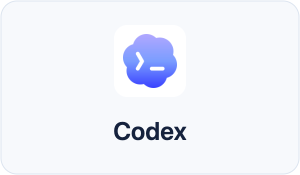</a>
  <a href="https://powercontext.oceanbase.io/zh/docs/integrations/claude-code/">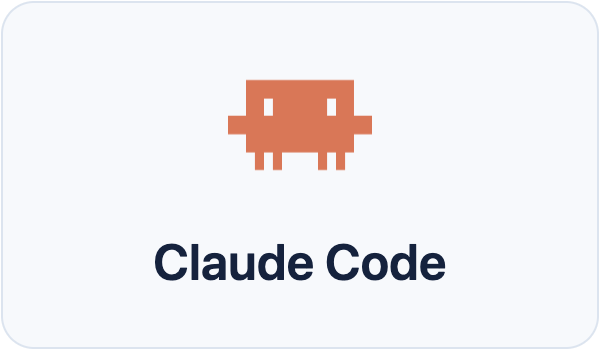</a>
  <a href="https://github.com/oceanbase/powercontext/tree/master/integrations/minimax#readme">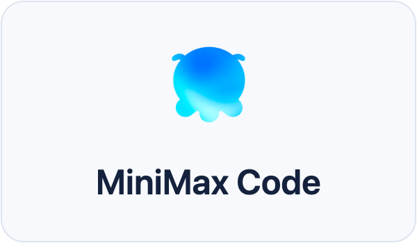</a>
  <a href="https://powercontext.oceanbase.io/zh/docs/integrations/dsh/">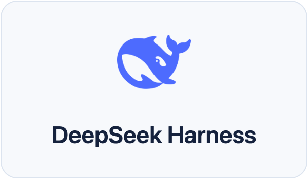</a>
  <a href="https://powercontext.oceanbase.io/zh/docs/integrations/zcode/">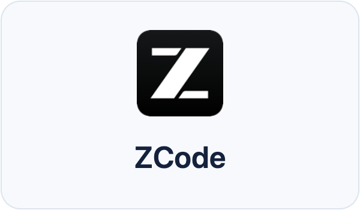</a>
</p>

<p align="center">
  <a href="https://powercontext.oceanbase.io/zh/docs/integrations/kimi-code/">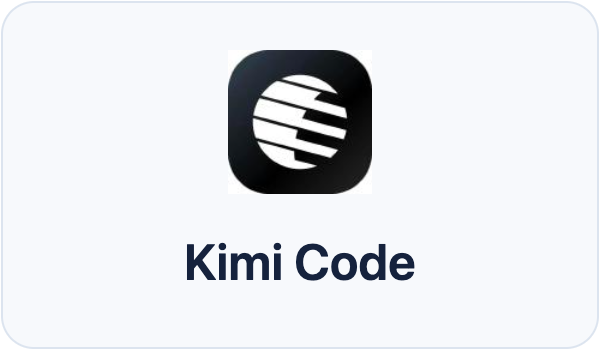</a>
  <a href="https://github.com/oceanbase/powercontext/tree/master/integrations/hermes#readme">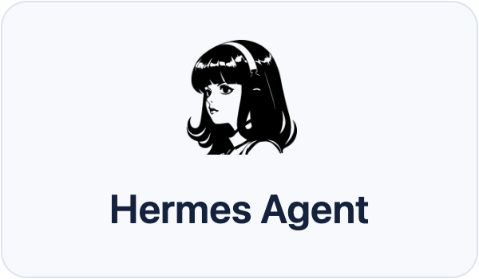</a>
  <a href="https://powercontext.oceanbase.io/zh/docs/integrations/pi/">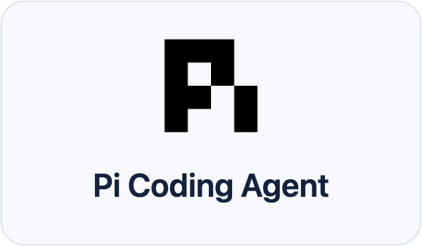</a>
  <a href="https://powercontext.oceanbase.io/zh/docs/integrations/openclaw/">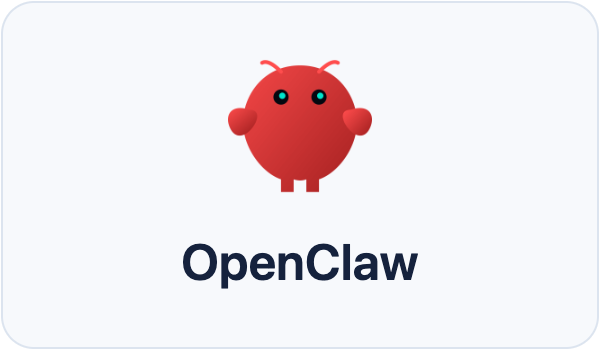</a>
  <a href="https://powercontext.oceanbase.io/zh/docs/integrations/opencode/">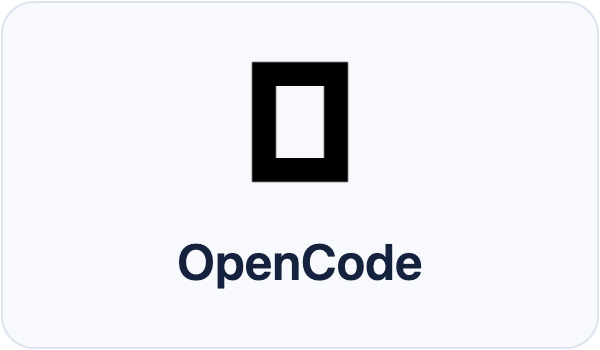</a>
</p>

<p align="center">
  <a href="https://github.com/oceanbase/powercontext/tree/master/integrations/workbuddy#readme">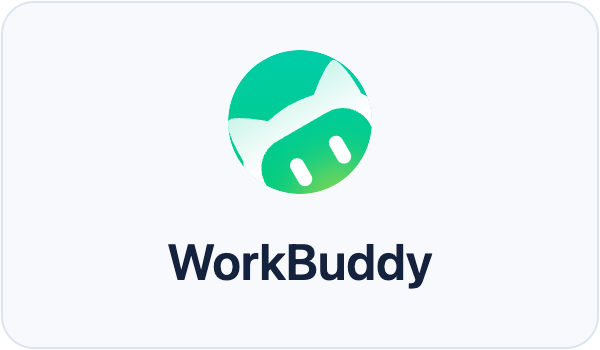</a>
  <a href="https://github.com/oceanbase/powercontext/tree/master/integrations/bub#readme">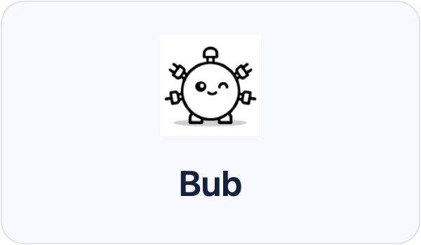</a>
  <a href="https://powercontext.oceanbase.io/zh/docs/integrations/pydantic-ai/">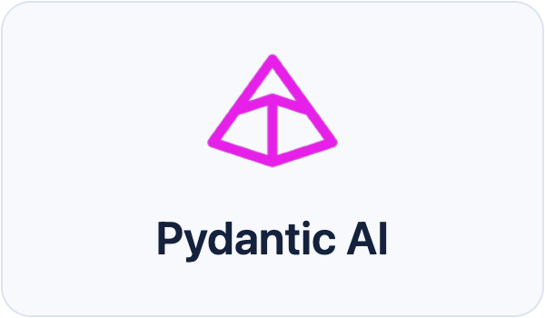</a>
  <a href="https://powercontext.oceanbase.io/zh/docs/integrations/langchain/">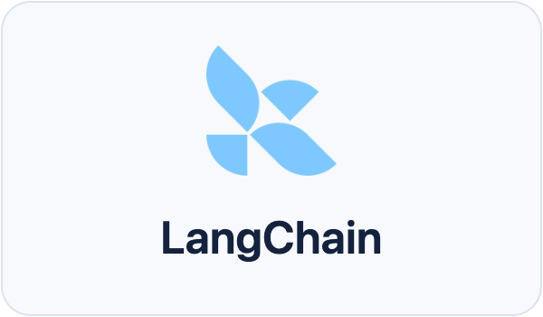</a>
  <a href="https://powercontext.oceanbase.io/zh/docs/integrations/langgraph/">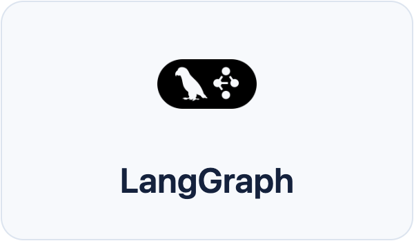</a>
</p>

Codex 为官方维护；其余 Agent 和 Python 框架集成为社区维护；Bub 仅用于评测。各项支持范围见能力对照。

[其他集成与能力对照 →](https://powercontext.oceanbase.io/zh/docs/integrations/capabilities/)

**应用与团队** — [Python / HTTP / MCP](https://powercontext.oceanbase.io/zh/docs/develop/interfaces/) · [记忆与任务交接](https://powercontext.oceanbase.io/zh/docs/workflows/memory-and-handoff/) · [部署与访问控制](https://powercontext.oceanbase.io/zh/docs/workflows/scopes-and-access/)

---

[文档](https://powercontext.oceanbase.io/zh/docs/) · [参与贡献](https://github.com/oceanbase/powercontext/blob/main/CONTRIBUTING.md) · [报告问题](https://github.com/oceanbase/powercontext/issues) · [Discord](https://discord.com/invite/74cF8vbNEs)

PowerContext 是[PowerMem](https://www.powermem.ai/)的后续项目，采用[Apache 2.0](LICENSE)发布。
