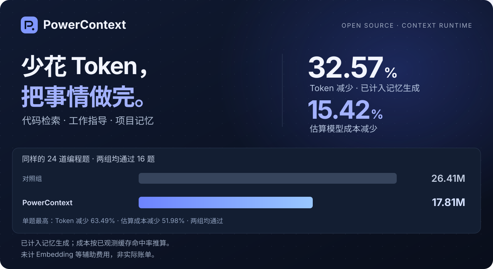
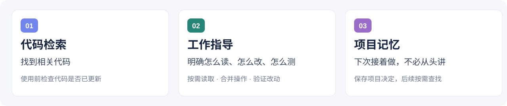

<p align="center">
  
</p>

<p align="center">
  <a href="#快速开始"><b>开始使用</b></a> &nbsp; · &nbsp;
  <a href="#效果证据">效果证据</a> &nbsp; · &nbsp;
  <a href="https://powercontext.oceanbase.io/zh/docs/">文档</a> &nbsp; · &nbsp;
  <a href="https://discord.com/invite/74cF8vbNEs">Discord</a>
</p>
<p align="center">
  <a href="README.md">English</a> · <a href="README_CN.md">中文</a> &nbsp; / &nbsp;
  <a href="https://pypi.org/project/powercontext/">Python package</a> · <a href="LICENSE">Apache 2.0</a>
</p>

## 为什么选 PowerContext？

**Agent 应该把 Token 花在推进任务上。** 少一些重复搜索，少一些无效往返，让已经确认的项目知识在下一次工作中继续派上用场。

- **聚焦当前任务。** 提供相关代码与明确的工作指导，帮助 Agent 更快进入修改和验证。
- **继续使用你的 Agent。** 通过现有集成接入 Codex、Claude Code 等宿主，也能嵌入自己的应用。
- **让上下文留下来。** 保存决定、约束和交接状态，换会话、换 Agent 或换人时仍有据可查。

## PowerContext 是什么？

**一个面向 AI Agent 的开源上下文运行时。** 管理代码上下文、项目记忆和任务交接，让合适的上下文在需要时进入工作流程。



按需配置这些能力。上下文按 **Scope** 组织，通过 HTTP、MCP、Python 和 Agent 集成访问。[了解工作方式 →](https://powercontext.oceanbase.io/zh/docs/workflows/memory-and-handoff/)

## 效果证据

<table>
<tr>
<td width="33%" align="center"><h3>40.30% ↓</h3><b>同 24 题总 Token</b><br/>MCS 对比 Gateway OFF<br/><sub>两组均通过 16/24</sub></td>
<td width="33%" align="center"><h3>36.18% ↓</h3><b>完整 121 题总 Token</b><br/>CS 对比 Gateway OFF<br/><sub>通过 82/121 对比 83/121</sub></td>
<td width="33%" align="center"><h3>85.71% ↓</h3><b>最高单题降幅</b><br/>CS · navidrome · case 302<br/><sub>双方均通过，不是平均值</sub></td>
</tr>
</table>

**一个具体例子：** case 302 从 **1,240,658 → 177,343 Token**，两次运行都通过了官方任务评分。

以上是主模型输入＋输出，含缓存；采用原始／冻结记录，**不等于费用降幅**。MCS 的额外记忆生成另计。[逐题数据与完整对照 →](docs/benchmarks/token-savings/README_CN.md)

<details>
<summary>测试范围、额外开销与复跑口径</summary>

- 同24题：S节省27.12%（15/24通过），CS节省33.06%（15/24），MCS节省40.30%（16/24）；Gateway OFF通过16/24。24题是已完成任务的交集，不是随机样本。
- MCS另有2,041,992 Token用于题后记忆生成。加上这一项，降幅为32.57%，仍未包含全部辅助开销。解题期间非空记忆注入为0，不能把节省归因于跨题记忆复用。
- 完整121题中，C单独开启反而多用10.53% Token；CS比OFF少通过1题。模型路线与验证步骤会变化，本次结果不代表每道题都省Token或质量相同。
- 后续复跑选中记录、全部尝试成本、缓存与未缓存用量均在证据页单列；没有混入首屏成绩。MCS未跑完全部121题。
- 使用Codex CLI 0.162.1、GPT-5.6 Sol medium、冻结开发构建及每次全新库。S是显式指导文本，不是安装后默认开启。历史OFF来自较早批次。

[统计方法](docs/benchmarks/token-savings/README_CN.md) · [数据](docs/benchmarks/token-savings/results.json) · [离线核算脚本](docs/benchmarks/token-savings/verify.py)

</details>

## 快速开始

需要 Python 3.11+、Git 和 [uv](https://docs.astral.sh/uv/getting-started/installation/)。下面固定使用1.5.0，适用于macOS和Linux。

```bash
uv tool install --force "powercontext[cli,server]==1.5.0"
mkdir -p powercontext-config && cd powercontext-config
powercontext config init --language zh --output .env
powercontext config validate --env-file .env
powercontext server run --env-file .env
```

保持服务运行，按生成的 **`.env.next-steps.md`** 创建并绑定Scope。首次体验可选基础记忆；自动提取需要Generation与Embedding凭据。

接入Codex，在新终端安装匹配版本的集成：

```bash
powercontext setup codex --ref powercontext-v1.5.0
powercontext doctor codex
```

开启新会话并按要求信任Hook，即可体验“保存项目决定 → 新会话召回”。[完整安装流程 →](https://powercontext.oceanbase.io/zh/docs/get-started/quickstart/)

<sub>以上启动上下文服务，不会自动复现评测中的Gateway、CodeGraph与Steering配置。测试配置见证据页。</sub>

## 接入你的工作流

**Agent** — [Codex](https://powercontext.oceanbase.io/zh/docs/integrations/codex/) · [Claude Code](https://powercontext.oceanbase.io/zh/docs/integrations/claude-code/) · [OpenCode、OpenClaw、Pi及能力矩阵](https://powercontext.oceanbase.io/zh/docs/integrations/capabilities/)

**应用与团队** — [Python / HTTP / MCP](https://powercontext.oceanbase.io/zh/docs/develop/interfaces/) · [Memory与Handoff](https://powercontext.oceanbase.io/zh/docs/workflows/memory-and-handoff/) · [部署与访问控制](https://powercontext.oceanbase.io/zh/docs/workflows/scopes-and-access/)

---

[文档](https://powercontext.oceanbase.io/zh/docs/) · [参与贡献](https://github.com/oceanbase/powercontext/blob/main/CONTRIBUTING.md) · [报告问题](https://github.com/oceanbase/powercontext/issues) · [Discord](https://discord.com/invite/74cF8vbNEs)

PowerContext是[PowerMem](https://www.powermem.ai/)的后续项目，基于[Apache 2.0](LICENSE)发布。
