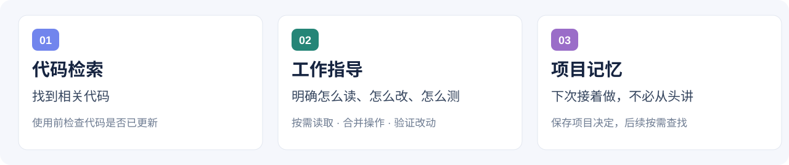

<p align="center">
  <picture>
    <source media="(prefers-color-scheme: dark)" srcset="docs/assets/readme-hero-zh-dark.gif" />
    
  </picture>
</p>

<p align="center">
  <a href="#快速开始"><b>开始使用</b></a> &nbsp; · &nbsp;
  <a href="#效果证据">效果证据</a> &nbsp; · &nbsp;
  <a href="#让上下文在更多场景中发挥作用">应用场景</a> &nbsp; · &nbsp;
  <a href="https://powercontext.oceanbase.io/zh/docs/">文档</a> &nbsp; · &nbsp;
  <a href="https://discord.com/invite/74cF8vbNEs">Discord</a>
</p>
<p align="center">
  <a href="README.md">English</a> · <a href="README_CN.md">中文</a> · <a href="README_JP.md">日本語</a> &nbsp; / &nbsp;
  <a href="https://pypi.org/project/powercontext/">Python package</a> · <a href="LICENSE">Apache 2.0</a>
</p>

## 为什么选 PowerContext？

**准、快、省。让 Agent 找准上下文，少走弯路。** PowerContext 把相关知识、用户偏好、任务进展和已有经验带到当前任务，帮助 Agent 减少重复搜索、反复确认和无效尝试，把时间和 Token 用在推进工作上。

- **准：提供当前需要的上下文。** 按任务查找相关知识和代码，保留依据，使用代码前检查是否已更新。
- **快：少摸索，少往返。** 接着已有进度做，参考已确认的方法和约束，减少重新理解背景与反复试错的时间。
- **省：减少完成任务的总开销。** 让一次模型调用更有效，减少不必要的推理和工具往返，也少让用户等待、重讲背景。

## PowerContext 是什么？

**PowerContext 是面向 AI Agent 的开源上下文服务。** 它把对话、资料和工作记录整理成可检索、可更新、可追溯的知识，让 Agent 了解这个人、掌握这个项目、接着上次的进度工作。

每个人都可以在自己的 Scope 中定制记忆处理提示词：重点记住什么、如何整理信息、怎样生成画像和经验。配合个人画像、项目知识和任务交接，让积累的上下文更适合不同的人与工作。

可以直接运行服务，通过 HTTP、MCP、Python 或 Agent 集成接入，也可以将 Core 嵌入自己的应用。[了解产品与工作流 →](https://powercontext.oceanbase.io/zh/docs/workflows/memory-and-handoff/)

## 效果证据

**省下 Token，也省下模型成本。** 在 SWE-bench Pro 同 24 道题的对比中，计入记忆生成后，Token 总量减少 **32.57%**，估算模型成本减少 **15.42%**；两组解出的是**相同的 16 题**。

**只看解题，Token 减少 40.30%；计入记忆生成成本后，仍减少 32.57%。** 记忆还可以在后续会话中反复复用，让已积累的知识继续发挥价值。本次测试衡量当轮开销，后续复用的收益尚未计入。

**单题最高省下 63.49% Token、51.98% 估算模型成本。** 第 456 题，两组均通过，Token 从 230 万降到 84 万，已计入记忆生成。

[查看 24 题评测：逐题结果、统计口径与复现配置 →](docs/benchmarks/token-savings/README_CN.md)

### 编程场景：少走弯路，少花 Token

**让每次推理更有效，减少完成任务所需的往返。** 相关代码、明确的工作要求和已有经验，能帮助 Agent 更快找到下一步该做什么。我们关注完成整项任务所花的时间和 Token，把重复探索、重读背景和无效尝试作为优化重点。

本次评测采用**网关模式**，同时开启代码检索、工作指导和项目记忆：



**生成记忆，也复用已有缓存。** 上面的 32.57% 已计入记忆生成开销。PowerContext 在网关模式下可以开启前缀缓存记忆提取，在满足条件时复用解题请求的上下文前缀，降低缓存命中部分的输入成本。本次评测中，记录了缓存字段的记忆生成调用，97% 的输入命中了缓存。

### 更少的模型往返

**另一次同 24 题的测试中，主模型请求减少 23.87%。** 开启记忆与工作指导后，请求总数从 **708 次降到 539 次**，平均每题从 **29.50 次降到 22.46 次**；两组解出的都是**同样 15 题**。这次测试与头图的代码检索、工作指导、记忆组合测试分别统计。[查看请求次数与逐题记录 →](docs/benchmarks/token-savings/request-counts_CN.md)

## 让上下文在更多场景中发挥作用

### 你的记忆，你来定义

**每个人，都可以有自己的记忆规则。** 工程师关注技术决策和故障原因，产品经理关注需求与方案取舍，创作者关注表达偏好和作品设定。你可以在个人 Scope 中定制提示词，调整记忆提取、信息整理和画像生成的重点，配置会独立保存并保留版本。

画像帮助 Agent 了解你；个人提示词让你定义系统怎样积累对你有用的记忆。让每一次使用留下的内容，更适合你的工作和习惯。

[Prompt：定制记忆规则 →](https://powercontext.oceanbase.io/zh/docs/workflows/manage-prompts/) · [Profile：了解每个用户 →](https://powercontext.oceanbase.io/zh/docs/workflows/use-profiles/)

### 换个会话，也能接着做

**工作可以中断，进度不必重来。** 排查过哪些原因、已经验证了什么、还有什么阻塞、下一步做什么，都可以留下来。换个会话或交给另一个 Agent，先核对当前状态，再从交接点继续。

Memory 保留决定与约束，Handoff 整理目标、进展和下一步。适合跨天任务、多人协作和多 Agent 交接。

[Memory 与 Handoff：保存进度、接续任务 →](https://powercontext.oceanbase.io/zh/docs/workflows/memory-and-handoff/)

### 项目越做越久，背景不用反复交代

**项目有来龙去脉，Agent 也应该知道。** 当初为什么选这个方案？客户提出过哪些要求？研究已经有哪些结论？把分散在资料和讨论中的信息，整理成持续更新的主题知识，需要时找到背景与依据。

Topic Memory 汇总同一主题的进展，Memory 保留具体事实，Source 留下原始依据。适合产品研发、客户项目和长期研究。

[Topic Memory：持续整理项目知识 →](https://powercontext.oceanbase.io/zh/docs/workflows/topic-memory/) · [Source：回到原始依据 →](https://powercontext.oceanbase.io/zh/docs/workflows/sources/)

### 解决过一次，下一次少走弯路

**把一次解决问题的经验，变成下一次的起点。** 留下有效的方法、适用条件、失败教训和验证步骤。下次遇到类似任务，Agent 可以先查已有经验，再决定如何行动。

Experience 沉淀情境、做法与结果；适合重复使用的流程可以整理为 Skill，确认后导出给 Agent 使用。让做过的工作持续产生价值。

[Experience：积累可复用的经验 →](https://powercontext.oceanbase.io/zh/docs/workflows/experience-and-skill-lifecycle/) · [Skill：导出经过确认的工作方法 →](https://powercontext.oceanbase.io/zh/docs/workflows/create-and-export-skill/)

个人、项目和团队可以使用各自的 Scope 管理上下文，结合访问控制决定谁能读取和修改；内容保留版本与来源，便于核对、修订和交接。[了解 Scope 与访问控制 →](https://powercontext.oceanbase.io/zh/docs/workflows/scopes-and-access/)

## 快速开始

需要 Python 3.11+、Git 和 [uv](https://docs.astral.sh/uv/getting-started/installation/)；接入 Agent 时还需安装对应的 CLI。以下命令安装 **1.5.2**，适用于 macOS 和 Linux；Windows 为实验性支持。需要自动准备 Python 和 uv 时，可使用[安装脚本](https://powercontext.oceanbase.io/zh/docs/get-started/install-and-run/#使用推荐安装脚本)。

首次体验可在向导中选择**基础记忆**，显式保存与召回不需要为 Server 配置模型 API；自动提取需要选择**完整记忆能力**并配置生成模型和 Embedding 凭据。存储可先选 SQLite。

```bash
uv tool install --force "powercontext[cli,server]==1.5.2"
mkdir -p powercontext-config && cd powercontext-config
powercontext config init --language zh --output .env
powercontext config validate --env-file .env
powercontext service install --env-file .env
powercontext service status
```

关闭终端后，服务仍会继续运行。Linux 需要可用的 `systemd --user` 管理器。向导生成的 `.env` 和 `.env.next-steps.md` 可能包含凭据，请勿提交到 Git。

加载生成的配置，检查服务状态：

```bash
set -a
. ./.env
set +a
powercontext ready
powercontext capabilities
```

按 **`.env.next-steps.md`** 创建并绑定 Scope，使用创建请求返回的真实 `scope_id`。Agent 和 Dashboard 要连接同一个 Server 和 Scope；切换工作目录不会自动隔离项目。修改 `.env` 后，重新加载环境文件，并执行 `powercontext service install --env-file .env` 使配置生效。

接入 Codex 时，安装对应版本的集成：

```bash
powercontext setup codex --env-file .env --ref powercontext-v1.5.2
powercontext doctor codex
```

在新 Codex 会话发送第一条消息前，打开 **`/hooks`** 检查并按提示信任 PowerContext Hook。即使 MCP 已连通，自动采集输入和召回上下文仍需要启用 `UserPromptSubmit` Hook。[首次会话检查与恢复 →](https://powercontext.oceanbase.io/zh/docs/integrations/codex/#首次会话-hook-信任)

按所选模式检查是否生效：

- **基础记忆：** 明确要求 Agent 保存一条项目决定，再用同一 Scope 开启新会话，要求它带来源找回。
- **完整记忆能力：** 确认输入已进入 Source，等待配置的后台处理生成 Topic Memory，再检查相关更新是否被记录，并能在新会话中找回。

`doctor codex` 只检查安装与连接。采集到 Source 不等于已生成记忆，自动处理还需要调度和模型运行。基础记忆模式下，Agent 仍使用自己的模型。[完整安装流程 →](https://powercontext.oceanbase.io/zh/docs/get-started/quickstart/)

<sub>以上命令用于启动服务。要复现测试中的网关、代码检索和工作指导配置，请查看详细报告。</sub>

## 接入你的工作流

<!-- Add integrations using an original logo asset, a product name, and a documentation link. -->
<table width="100%">
  <tr>
    <td align="center" width="20%"><a href="https://powercontext.oceanbase.io/zh/docs/integrations/codex/"><br />Codex</a></td>
    <td align="center" width="20%"><a href="https://powercontext.oceanbase.io/zh/docs/integrations/claude-code/"><br />Claude Code</a></td>
    <td align="center" width="20%"><a href="https://github.com/oceanbase/powercontext/tree/master/integrations/minimax#readme"><br />MiniMax Code</a></td>
    <td align="center" width="20%"><a href="https://powercontext.oceanbase.io/zh/docs/integrations/dsh/"><br />DeepSeek Harness</a></td>
    <td align="center" width="20%"><a href="https://powercontext.oceanbase.io/zh/docs/integrations/zcode/"><br />ZCode</a></td>
  </tr>
  <tr>
    <td align="center" width="20%"><a href="https://powercontext.oceanbase.io/zh/docs/integrations/kimi-code/"><br />Kimi Code</a></td>
    <td align="center" width="20%"><a href="https://github.com/oceanbase/powercontext/tree/master/integrations/hermes#readme"><br />Hermes Agent</a></td>
    <td align="center" width="20%"><a href="https://powercontext.oceanbase.io/zh/docs/integrations/pi/"><br />Pi Coding Agent</a></td>
    <td align="center" width="20%"><a href="https://powercontext.oceanbase.io/zh/docs/integrations/openclaw/"><br />OpenClaw</a></td>
    <td align="center" width="20%"><a href="https://powercontext.oceanbase.io/zh/docs/integrations/opencode/"><br />OpenCode</a></td>
  </tr>
  <tr>
    <td align="center" width="20%"><a href="https://github.com/oceanbase/powercontext/tree/master/integrations/workbuddy#readme"><br />WorkBuddy</a></td>
    <td align="center" width="20%"><a href="https://github.com/oceanbase/powercontext/tree/master/integrations/bub#readme"><br />Bub</a></td>
    <td align="center" width="20%"><a href="https://powercontext.oceanbase.io/zh/docs/integrations/pydantic-ai/"><br />Pydantic AI</a></td>
    <td align="center" width="20%"><a href="https://powercontext.oceanbase.io/zh/docs/integrations/langchain/"><br />LangChain</a></td>
    <td align="center" width="20%"><a href="https://powercontext.oceanbase.io/zh/docs/integrations/langgraph/"><br />LangGraph</a></td>
  </tr>
</table>

Codex 为官方维护；其余 Agent 和 Python 框架集成为社区维护；Bub 仅用于评测。各项支持范围见能力对照。

[其他集成与能力对照 →](https://powercontext.oceanbase.io/zh/docs/integrations/capabilities/)

**应用与团队** — [Python / HTTP / MCP](https://powercontext.oceanbase.io/zh/docs/develop/interfaces/) · [记忆与任务交接](https://powercontext.oceanbase.io/zh/docs/workflows/memory-and-handoff/) · [部署与访问控制](https://powercontext.oceanbase.io/zh/docs/workflows/scopes-and-access/)

---

[文档](https://powercontext.oceanbase.io/zh/docs/) · [参与贡献](https://github.com/oceanbase/powercontext/blob/master/CONTRIBUTING.md) · [报告问题](https://github.com/oceanbase/powercontext/issues) · [Discord](https://discord.com/invite/74cF8vbNEs)

PowerContext 是[PowerMem](https://www.powermem.ai/)的后续项目，采用[Apache 2.0](LICENSE)发布。
