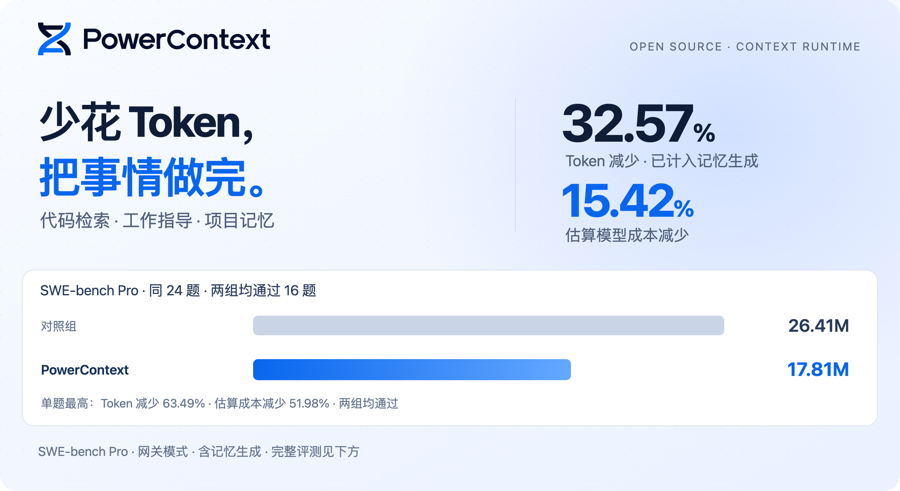
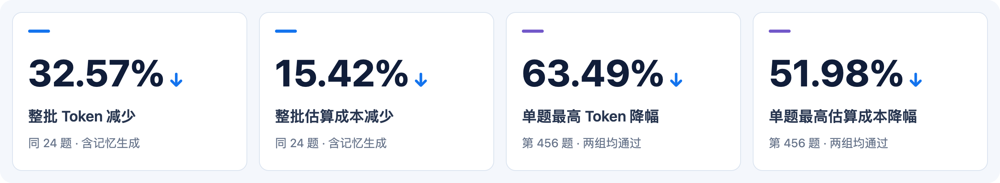
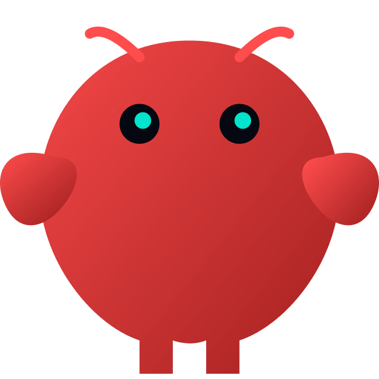
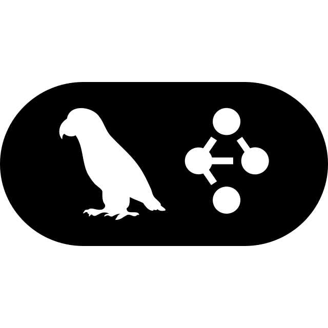

<p align="center">
  
</p>

<p align="center">
  <a href="#快速开始"><b>开始使用</b></a> &nbsp; · &nbsp;
  <a href="#效果证据">效果证据</a> &nbsp; · &nbsp;
  <a href="https://powercontext.oceanbase.io/zh/docs/">文档</a> &nbsp; · &nbsp;
  <a href="https://discord.com/invite/74cF8vbNEs">Discord</a>
</p>
<p align="center">
  <a href="README.md">English</a> · <a href="README_CN.md">中文</a> &nbsp; / &nbsp;
  <a href="https://pypi.org/project/powercontext/">Python package</a> · <a href="LICENSE">Apache 2.0</a>
</p>

## 为什么选 PowerContext？

**让 Agent 少花 Token，把事情做完。** 写代码时，反复搜文件、读整段源码、重复尝试同一条路，都在消耗 Token。PowerContext 帮助 Agent 找到相关代码、遵循项目要求，并记住已经确认的信息。

- **少翻无关代码。** 按任务查找相关代码，使用前检查代码是否已更新。
- **少走弯路。** 把项目约束和工作要求交给 Agent，例如只读必要片段、合并独立操作、优先跑相关测试。
- **换个会话，也能接着做。** 保存项目决定、约束和任务进度，下次需要时再取出来。

## PowerContext 是什么？

**PowerContext 是面向 AI Agent 的开源上下文服务，让工作跨会话、跨 Agent、跨团队延续。** 把决定、约束、证据和进度保存在对话之外，换个会话或接手人，也能从当前状态继续。

- **记忆与任务交接：** 保存有用信息，交代任务做到哪一步、下一步做什么。
- **经验与技能：** 把实践中验证过的方法整理为可复用的经验和流程，经审核后再使用。
- **可追溯的上下文：** 按 Scope 隔离项目，保留内容版本和来源，按当前任务需要检索。

可以直接运行服务，通过 HTTP、MCP、Python 或 Agent 集成接入，也可以将 Core 嵌入自己的应用。[了解产品与工作流 →](https://powercontext.oceanbase.io/zh/docs/workflows/memory-and-handoff/)

## 效果证据

**省下 Token，也省下模型成本。** 在 SWE-bench Pro 同 24 道题的对比中，计入记忆生成后，Token 总量减少 **32.57%**，估算模型成本减少 **15.42%**；两组均通过 **16 题**。



**只看解题，Token 减少 40.30%；计入记忆生成成本后，仍减少 32.57%。** 记忆还可以在后续会话中反复复用，让已积累的知识继续发挥价值。本次测试衡量当轮开销，后续复用的收益尚未计入。

**单题最高省下 63.49% Token、51.98% 估算模型成本。** 第 456 题，两组均通过，Token 从 230 万降到 84 万，已计入记忆生成。

[查看完整评测：逐题结果、统计口径与复现配置 →](docs/benchmarks/token-savings/README_CN.md)

### 编程场景：把上下文用在任务上

本次评测采用**网关模式**，同时开启代码检索、工作指导和项目记忆：


**提取记忆，也复用已有缓存。** PowerContext 在网关模式下支持前缀缓存记忆提取，复用解题请求的上下文前缀，降低缓存命中部分的输入成本。让 Agent 留下有用的记忆，也照顾生成记忆的开销。

## 快速开始

需要 Python 3.11+、Git 和 [uv](https://docs.astral.sh/uv/getting-started/installation/)。以下命令安装 1.5.0，适用于 macOS 和 Linux。

```bash
uv tool install --force "powercontext[cli,server]==1.5.0"
mkdir -p powercontext-config && cd powercontext-config
powercontext config init --language zh --output .env
powercontext config validate --env-file .env
powercontext server run --env-file .env
```

保持服务运行，按生成的 **`.env.next-steps.md`** 创建并绑定 Scope。首次使用可选择基础记忆；若要自动提取记忆，还需要配置生成模型和 Embedding 模型的凭据。

接入 Codex 时，在另一个终端安装对应版本的集成：

```bash
powercontext setup codex --ref powercontext-v1.5.0
powercontext doctor codex
```

启动新会话并按提示信任 Hook。可以先保存一条项目决定，再开一个会话，检查能否找回。[完整安装流程 →](https://powercontext.oceanbase.io/zh/docs/get-started/quickstart/)

<sub>以上命令用于启动服务。要复现测试中的网关、代码检索和工作指导配置，请查看详细报告。</sub>

## 接入你的工作流

<!-- Add integrations using an original logo asset, a product name, and a documentation link. -->
<table width="100%">
  <tr>
    <td align="center" width="20%"><a href="https://powercontext.oceanbase.io/zh/docs/integrations/codex/"><br />Codex</a></td>
    <td align="center" width="20%"><a href="https://powercontext.oceanbase.io/zh/docs/integrations/claude-code/"><br />Claude Code</a></td>
    <td align="center" width="20%"><a href="https://github.com/oceanbase/powercontext/tree/master/integrations/minimax#readme"><br />MiniMax Code</a></td>
    <td align="center" width="20%"><a href="https://powercontext.oceanbase.io/zh/docs/integrations/dsh/"><br />DeepSeek Harness</a></td>
    <td align="center" width="20%"><a href="https://powercontext.oceanbase.io/zh/docs/integrations/zcode/"><br />ZCode</a></td>
  </tr>
  <tr>
    <td align="center" width="20%"><a href="https://powercontext.oceanbase.io/zh/docs/integrations/kimi-code/"><br />Kimi Code</a></td>
    <td align="center" width="20%"><a href="https://github.com/oceanbase/powercontext/tree/master/integrations/hermes#readme"><br />Hermes Agent</a></td>
    <td align="center" width="20%"><a href="https://powercontext.oceanbase.io/zh/docs/integrations/pi/"><br />Pi Coding Agent</a></td>
    <td align="center" width="20%"><a href="https://powercontext.oceanbase.io/zh/docs/integrations/openclaw/"><br />OpenClaw</a></td>
    <td align="center" width="20%"><a href="https://powercontext.oceanbase.io/zh/docs/integrations/opencode/"><br />OpenCode</a></td>
  </tr>
  <tr>
    <td align="center" width="20%"><a href="https://github.com/oceanbase/powercontext/tree/master/integrations/workbuddy#readme"><br />WorkBuddy</a></td>
    <td align="center" width="20%"><a href="https://github.com/oceanbase/powercontext/tree/master/integrations/bub#readme"><br />Bub</a></td>
    <td align="center" width="20%"><a href="https://powercontext.oceanbase.io/zh/docs/integrations/pydantic-ai/"><br />Pydantic AI</a></td>
    <td align="center" width="20%"><a href="https://powercontext.oceanbase.io/zh/docs/integrations/langchain/"><br />LangChain</a></td>
    <td align="center" width="20%"><a href="https://powercontext.oceanbase.io/zh/docs/integrations/langgraph/"><br />LangGraph</a></td>
  </tr>
</table>

Codex 为官方维护；其余 Agent 和 Python 框架集成为社区维护；Bub 仅用于评测。各项支持范围见能力对照。

[其他集成与能力对照 →](https://powercontext.oceanbase.io/zh/docs/integrations/capabilities/)

**应用与团队** — [Python / HTTP / MCP](https://powercontext.oceanbase.io/zh/docs/develop/interfaces/) · [记忆与任务交接](https://powercontext.oceanbase.io/zh/docs/workflows/memory-and-handoff/) · [部署与访问控制](https://powercontext.oceanbase.io/zh/docs/workflows/scopes-and-access/)

---

[文档](https://powercontext.oceanbase.io/zh/docs/) · [参与贡献](https://github.com/oceanbase/powercontext/blob/main/CONTRIBUTING.md) · [报告问题](https://github.com/oceanbase/powercontext/issues) · [Discord](https://discord.com/invite/74cF8vbNEs)

PowerContext 是[PowerMem](https://www.powermem.ai/)的后续项目，采用[Apache 2.0](LICENSE)发布。
