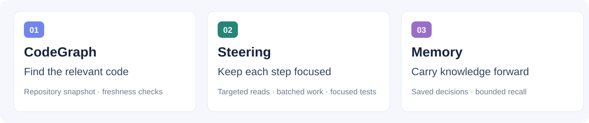

<p align="center">
  <picture>
    <source media="(prefers-color-scheme: dark)" srcset="docs/assets/readme-hero-en-dark.gif" />
    
  </picture>
</p>

<p align="center">
  <a href="#クイックスタート"><b>使い始める</b></a> &nbsp; · &nbsp;
  <a href="#効果の検証">検証結果</a> &nbsp; · &nbsp;
  <a href="#さまざまな場面でコンテキストを活かす">活用シーン</a> &nbsp; · &nbsp;
  <a href="https://powercontext.oceanbase.io/en/docs/">ドキュメント</a> &nbsp; · &nbsp;
  <a href="https://discord.com/invite/74cF8vbNEs">Discord</a>
</p>
<p align="center">
  <a href="README.md">English</a> · <a href="README_CN.md">中文</a> · <a href="README_JP.md">日本語</a> &nbsp; / &nbsp;
  <a href="https://pypi.org/project/powercontext/">Python パッケージ</a> · <a href="LICENSE">Apache 2.0</a>
</p>

本文中のドキュメントリンクと図中の表記は英語版です。

## なぜ PowerContext なのか？

**的確に、素早く、無駄なく。必要なコンテキストで、Agent の遠回りを減らす。** PowerContext は、関連する知識、ユーザーの好み、タスクの進捗、過去の経験を今のタスクに届けます。検索の繰り返し、何度もの確認、成果につながらない試行を減らし、時間とトークンを作業の前進に使えるよう支援します。

- **的確に：今のタスクに必要なコンテキストを届ける。** 関連する知識やコードをタスクに応じて探し、根拠を残し、コードを使う前に更新の有無を確認します。
- **素早く：調べ直しや往復を減らす。** これまでの進捗を引き継ぎ、確認済みの方法や制約を参照して、背景の把握や試行錯誤にかかる時間を減らせるようにします。
- **無駄なく：タスク完了までの総コストを抑える。** 1 回ごとのモデル呼び出しを有効に使い、不要な推論やツールとの往復、ユーザーの待ち時間や背景を説明し直す手間を減らせるようにします。

## PowerContext とは？

**PowerContext は、AI Agent 向けのオープンソース・コンテキストサービスです。** 会話、資料、作業記録を、検索・更新でき、出典をたどれる知識に整理します。Agent がユーザーやプロジェクトを理解し、前回の続きから作業できるようにします。

[多彩な Artifact で知識を整理 →](https://powercontext.oceanbase.io/en/docs/workflows/artifacts/) · [Dream で継続的に改善 →](https://powercontext.oceanbase.io/en/docs/workflows/review-dream-revisions/) · [プラグインで柔軟に拡張 →](https://powercontext.oceanbase.io/en/docs/develop/plugins/)

HTTP、MCP、Python、Agent 連携を通じてサービスとして利用するほか、Core をアプリケーションに組み込むこともできます。[製品とワークフローを詳しく見る →](https://powercontext.oceanbase.io/en/docs/workflows/memory-and-handoff/)

## 効果の検証

**トークンを減らし、モデルコストも抑える。** SWE-bench Pro の同じ 24 タスクで、PowerContext は記憶の生成を含めてトークン数を **32.57%**、推定モデルコストを **15.42%** 削減しました。両群が解決したのは**同じ 16 タスク**です。

**問題解決のみではトークン数が 40.30% 減少し、記憶の生成に使った分を含めても 32.57% 減少しました。** 保存した記憶は後のセッションで再利用できます。このベンチマークが測ったのは今回の実行であり、後の再利用による効果は測定していません。

**単一タスクで最大 63.49% のトークン削減、51.98% の推定モデルコスト削減。** タスク 456 は両群とも解決し、記憶の生成を含むトークン数は 230 万から 84 万に減少しました。

[24 タスクの検証結果、集計方法、実行設定を見る →](docs/benchmarks/token-savings/README.md)

### コーディング：探索のやり直しと不要な往復を減らす

**1 回ごとの推論を有効に使い、タスク完了までの往復を減らす。** 関連するコード、明確な作業要件、過去の経験は、Agent が次に何をすべきかを見つける手がかりになります。タスク全体にかかる時間とトークンに着目し、探索のやり直し、背景の読み直し、成果につながらない試行を減らすことを目指しています。

このベンチマークでは**ゲートウェイモード**を使い、コード検索、作業指針、プロジェクトの記憶を同時に有効にしています。



**記憶を抽出し、キャッシュも再利用する。** 上記の 32.57% には記憶の生成に使ったトークンも含まれています。ゲートウェイモードでは、プレフィックスキャッシュを使った記憶抽出を有効にできます。条件を満たす場合に問題解決リクエストのコンテキストプレフィックスを再利用し、キャッシュにヒットした入力のコストを抑えます。今回、キャッシュ項目が記録された記憶生成リクエストでは、入力の 97% がキャッシュにヒットしました。 [記憶抽出のコストと品質を検証した別のレポートを見る（英語） →](https://gist.github.com/jasper-yl/d02bfb7d9b45ca175bf74ad09cfa5ba4#file-00-report-en-md)

## さまざまな場面でコンテキストを活かす

<!-- Each card is editable HTML; keep text and links aligned across the three READMEs. -->
<table width="100%">
  <tr>
    <td colspan="2" width="1000" valign="top">
      
      <p><strong>一人ひとりに、自分だけの記憶ルール</strong></p>
      <h3>記憶のルールは、自分で</h3>
      <blockquote><p>「長く使う決定事項と制約だけを残し、一時的なやり取りは会話の中に。」</p></blockquote>
      <p>個人用 Scope のプロンプトで、覚える内容と整理の仕方を決められます。</p>
      <p><a href="https://powercontext.oceanbase.io/en/docs/workflows/manage-prompts/"><b>自分の記憶ルールを作る →</b></a></p>
    </td>
  </tr>
  <tr>
    <td width="50%" valign="top">
      
      <p><sub>Profile</sub></p>
      <h3>いつものやり方で</h3>
      <blockquote><p>「設計レビューは Yuque にまとめて。」</p></blockquote>
      <p>使うツール、書き方、仕事の進め方をプロフィールに残せます。</p>
      <p><a href="https://powercontext.oceanbase.io/en/docs/workflows/use-profiles/">プロフィールを見る →</a></p>
    </td>
    <td width="50%" valign="top">
      
      <p><sub>Topic Memory</sub></p>
      <h3>プロジェクトの経緯</h3>
      <p><code>日々の議論</code> → <code>テーマ別の要約</code> → <code>必要な詳細</code></p>
      <p>まず要約を読み、必要に応じて背景や根拠をたどれます。</p>
      <p><a href="https://powercontext.oceanbase.io/en/docs/workflows/topic-memory/">プロジェクトの知識を残す →</a></p>
    </td>
  </tr>
  <tr>
    <td width="50%" valign="top">
      
      <p><sub>Dream</sub></p>
      <h3>経験から見直す</h3>
      <p><code>過去の根拠</code> → <code>修正案</code> → <code>あなたが承認</code></p>
      <p>過去のやり取りをもとに記憶やプロンプトの修正を提案し、承認後に反映します。</p>
      <p><a href="https://powercontext.oceanbase.io/en/docs/workflows/review-dream-revisions/">Dream を見る →</a></p>
    </td>
    <td width="50%" valign="top">
      
      <p><sub>Handoff</sub></p>
      <h3>続きから再開</h3>
      <p><code>確認済みの進捗</code> → <code>次の手順</code> → <code>新しいセッション</code></p>
      <p>目標と進捗、次の手順を引き継ぎ、現状を確かめて再開できます。</p>
      <p><a href="https://powercontext.oceanbase.io/en/docs/workflows/memory-and-handoff/">作業を引き継ぐ →</a></p>
    </td>
  </tr>
</table>

## クイックスタート

Python 3.11+、Git、[uv](https://docs.astral.sh/uv/getting-started/installation/) と、接続する Agent の CLI が必要です。以下は macOS と Linux 向けにバージョン **1.5.2** をインストールする手順です。Windows のサポートは実験段階です。[インストールスクリプト](https://powercontext.oceanbase.io/en/docs/get-started/install-and-run/#install-with-the-recommended-script)を使えば、Python と uv も用意できます。

ウィザードは英語で表示されます。Server 用の追加のモデル API なしで明示的な保存と想起を試すには、**Basic memory** を選んでください。自動抽出には、Generation と Embedding の認証情報を設定した **Full memory** が必要です。最初のストレージには SQLite が手軽です。

```bash
uv tool install --force "powercontext[cli,server]==1.5.2"
mkdir -p powercontext-config && cd powercontext-config
powercontext config init --language en --output .env
powercontext config validate --env-file .env
powercontext service install --env-file .env
powercontext service status
```

サービスはターミナルを閉じた後も動作し続けます。Linux では `systemd --user` が利用できる必要があります。生成される `.env` と `.env.next-steps.md` には認証情報が含まれることがあるため、Git にコミットしないでください。

生成された環境ファイルを読み込み、サービスを確認します。

```bash
set -a
. ./.env
set +a
powercontext ready
powercontext capabilities
```

**`.env.next-steps.md`** に従って Scope を作成し、作成リクエストが返した実際の `scope_id` を使って紐付けます。Dashboard と Agent は同じ Server と Scope に接続してください。ディレクトリを変えるだけではプロジェクトは分離されません。`.env` を編集した場合は再度読み込み、`powercontext service install --env-file .env` を再実行して反映します。

Codex には対応するバージョンの連携をインストールします。

```bash
powercontext setup codex --env-file .env --ref powercontext-v1.5.2
powercontext doctor codex
```

新しい Codex セッションで最初のメッセージを送る前に、**`/hooks`** を開き、求められたら PowerContext Hook の信頼を許可してください。入力の自動取得と想起には `UserPromptSubmit` Hook の有効化が必要です。MCP に接続できるだけでは動作しません。[初回確認と復旧 →](https://powercontext.oceanbase.io/en/docs/integrations/codex/#first-session-hook-trust)

選んだワークフローを確認します。

- **Basic memory：** Agent にプロジェクトの判断を明示的に保存させ、同じ Scope の新しいセッションで、出典を参照しながら想起できることを確認します。
- **Full memory：** 入力が Source として保存され、設定した処理によって Topic Memory が生成されるのを待ちます。続いて関連する更新を送り、その内容が反映され、新しいセッションで想起できることを確認します。

`doctor codex` が確認するのはインストールと接続だけです。Source の取得だけでは記憶は作られず、自動処理には設定したスケジュールとモデルの実行も必要です。Basic memory でも Agent 自身のモデルは使用します。[完全なセットアップ手順 →](https://powercontext.oceanbase.io/en/docs/get-started/quickstart/)

<sub>この手順はコンテキストサービスを起動するものです。ベンチマークの Gateway、CodeGraph、Steering の設定は自動では再現されません。詳細は検証レポートを参照してください。</sub>

## 今のワークフローに接続する

<!-- Add integrations using an original logo asset, a product name, and a documentation link. -->
<table width="100%">
  <tr>
    <td align="center" width="20%"><a href="https://powercontext.oceanbase.io/en/docs/integrations/codex/"><br />Codex</a></td>
    <td align="center" width="20%"><a href="https://powercontext.oceanbase.io/en/docs/integrations/claude-code/"><br />Claude Code</a></td>
    <td align="center" width="20%"><a href="https://github.com/oceanbase/powercontext/tree/master/integrations/minimax#readme"><br />MiniMax Code</a></td>
    <td align="center" width="20%"><a href="https://powercontext.oceanbase.io/en/docs/integrations/dsh/"><br />DeepSeek Harness</a></td>
    <td align="center" width="20%"><a href="https://powercontext.oceanbase.io/en/docs/integrations/zcode/"><br />ZCode</a></td>
  </tr>
  <tr>
    <td align="center" width="20%"><a href="https://powercontext.oceanbase.io/en/docs/integrations/kimi-code/"><br />Kimi Code</a></td>
    <td align="center" width="20%"><a href="https://github.com/oceanbase/powercontext/tree/master/integrations/hermes#readme"><br />Hermes Agent</a></td>
    <td align="center" width="20%"><a href="https://powercontext.oceanbase.io/en/docs/integrations/pi/"><br />Pi Coding Agent</a></td>
    <td align="center" width="20%"><a href="https://powercontext.oceanbase.io/en/docs/integrations/openclaw/"><br />OpenClaw</a></td>
    <td align="center" width="20%"><a href="https://powercontext.oceanbase.io/en/docs/integrations/opencode/"><br />OpenCode</a></td>
  </tr>
  <tr>
    <td align="center" width="20%"><a href="https://github.com/oceanbase/powercontext/tree/master/integrations/workbuddy#readme"><br />WorkBuddy</a></td>
    <td align="center" width="20%"><a href="https://github.com/oceanbase/powercontext/tree/master/integrations/bub#readme"><br />Bub</a></td>
    <td align="center" width="20%"><a href="https://powercontext.oceanbase.io/en/docs/integrations/pydantic-ai/"><br />Pydantic AI</a></td>
    <td align="center" width="20%"><a href="https://powercontext.oceanbase.io/en/docs/integrations/langchain/"><br />LangChain</a></td>
    <td align="center" width="20%"><a href="https://powercontext.oceanbase.io/en/docs/integrations/langgraph/"><br />LangGraph</a></td>
  </tr>
</table>

Codex 連携は公式メンテナンス、その他の Agent と Python フレームワークの連携はコミュニティメンテナンスです。Bub は評価専用です。対応機能は機能一覧を参照してください。

[その他の連携と機能一覧 →](https://powercontext.oceanbase.io/en/docs/integrations/capabilities/)

**アプリケーションとチーム** — [Python / HTTP / MCP](https://powercontext.oceanbase.io/en/docs/develop/interfaces/) · [Memory と Handoff](https://powercontext.oceanbase.io/en/docs/workflows/memory-and-handoff/) · [デプロイとアクセス制御](https://powercontext.oceanbase.io/en/docs/workflows/scopes-and-access/)

---

[ドキュメント](https://powercontext.oceanbase.io/en/docs/) · [開発に参加](https://github.com/oceanbase/powercontext/blob/master/CONTRIBUTING.md) · [問題を報告](https://github.com/oceanbase/powercontext/issues) · [Discord](https://discord.com/invite/74cF8vbNEs)

PowerContext は [PowerMem](https://www.powermem.ai/) の後継プロジェクトであり、[Apache 2.0](LICENSE) ライセンスで公開されています。
